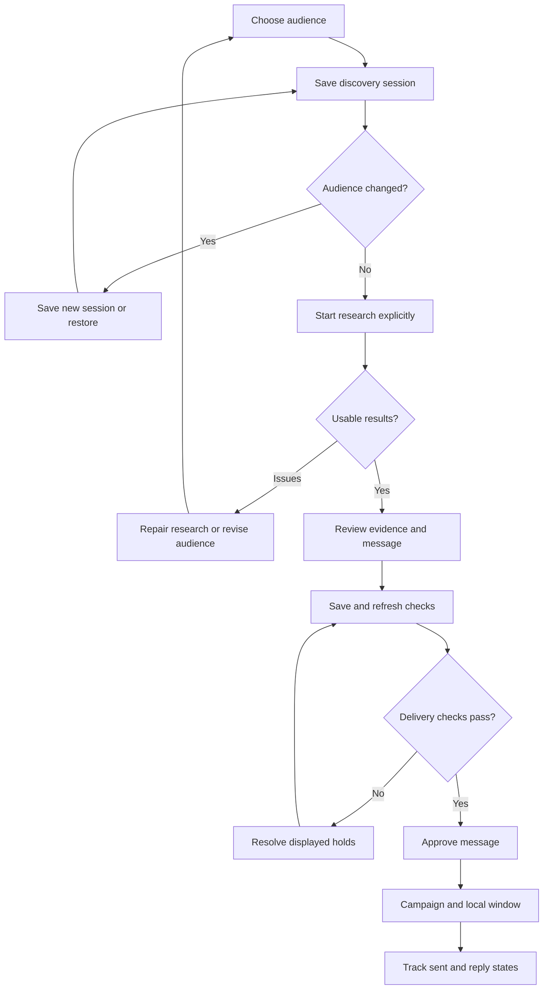

# User flows and information architecture — Shine v0.15.0

## Main navigation

| Area | User question | Information and actions |
|---|---|---|
| Find clients | Who should I contact next? | Country/city, company type, industries, opportunity kind, candidate limit; saved audience; explicit research action; current activity, manual fallback and history. |
| Review & results | What did research find, and is the message appropriate? | Cross-session counts; session, status, type and search filters; company evidence; message editing; delivery review and blockers. |
| Campaign & delivery | How many messages can send, and why are some waiting? | Campaign total; daily ceiling and local window; campaign progress; worker/setup explanation; outbox; readiness and suppression records. |
| Setup & preferences | What stays the same between sessions? | Reusable title/skill/country rules, availability and posting age; editable targeting suggestions; account and API connection information. |

The four-step workflow strip is navigation. It never starts research, creates a campaign, approves a message or sends an email.

## 1. First-time or incomplete setup

1. Open Setup & preferences. Missing title/skill rules are explicitly identified.
2. Choose Use suggested email-design targeting to populate the form. Review and edit it. This is unsaved until Save targeting preferences is chosen.
3. Check countries, weekly capacity and posting age. Saving targeting affects the policy fingerprint, so a previous sending-policy approval may no longer match.
4. Check account/API connection information. A present key or token is not proof of successful live access. Credentials are entered through the existing local configuration commands.
5. Follow the existing sender verification and policy approval setup. Nothing in the navigation bypasses it.

Recovery: Discard changes restores saved preferences. Leaving the page with edits triggers the existing leave-page warning. Missing setup does not delete earlier research.

## 2. On-demand discovery

1. Choose country/city, company type, opportunity kind and optional or required industries. Brands require at least one industry.
2. Choose a candidate limit. Automatic research supports up to ten candidates in this pilot; its limits are separate from a campaign’s sending target.
3. Create discovery session. This saves the audience and prompt without buying research or sending email.
4. Check the Saved discovery session summary. Research always uses that saved audience.
5. Choose Search and draft automatically only when ready. The existing API reservations, source access, exclusion, evidence and duplicate rules apply.
6. Watch the current session’s progress. Keep the app and Mac awake while it works. Earlier logs remain in history.
7. Choose Review session results. The pipeline opens with that session selected, including records without a valid draft so they can be repaired.

If the form is edited after the session is saved, automatic research is disabled. Either create a new session for those changes or Use this saved audience to restore the saved values. Restoring does not start research.

If no matches are found, adjust the audience and create a new session. If some drafts are rejected, company records remain available for evidence repair. A session is not automatically repeated after a provider failure.

## 3. Evidence → message → delivery review

1. Select a researched company. The detail view separates three review sections with keyboard-accessible links.
2. Evidence: verify company identity, location, intended contact route and personalization sources. A prospective client is not presented as a vacancy.
3. Message: check the company-specific subject/body, exact portfolio link, pricing and closing. Editable evidence remains in advanced JSON.
4. Save draft and refresh review. The dialog reloads the saved record and current checks, so the user does not need to close and find the company again.
5. Check delivery details and approve only when the existing blockers are resolved. Approval remains a separate action after saving.

Recovery: unsaved edits are protected on dismissal. Invalid draft data stays visible with the correction message. Failed Notion sync keeps the local save and requires sync before approval. An approval action never silently ignores an edited draft.

## 4. Campaign and scheduled delivery

1. Set a campaign total, such as 20, 30 or 50. This total spans days and restarts and does not create a recurring campaign.
2. Read the separate daily ceiling, company-local sending window and spacing. A campaign target does not guarantee that enough qualified, approved recipients exist.
3. Check Production readiness and message-level holds. The new guidance explains whether the Run-Shine worker is detected, paused or held by configuration.
4. Run the existing Run-Shine command and keep the Mac awake. Eligible queued messages are processed under the existing policy and company-local windows.
5. Review outbox states and results. Uncertain delivery, reply, rejection, opt-out, bounce and suppression rules remain unchanged.

A research session is not a sending campaign. Creating a session, filling targeting suggestions, saving a message and navigating to delivery do not authorize sending by themselves. Daily and campaign limits remain distinct.

## Flow map

## What was verified

The previous 224 offline tests pass with additional assertions that automatic results expose the correct session identity. Browser checks use sample data and test-only keys without calling research providers: targeting suggestions and discard, session creation, changed-audience block, restore, session-specific empty results, global review navigation, review section links and delivery guidance. The save-and-refresh transition is tested in the isolated local app; it does not approve or send the saved message.

No production messages or paid research requests were triggered. The existing Mac installation is updated only when its installer is run. Cloud deployment remains deferred.
